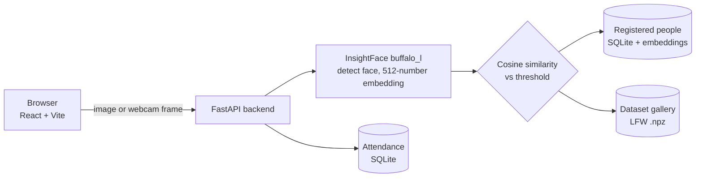

# FacialIQ

A local face-recognition web app built on **ArcFace** (InsightFace `buffalo_l`).
Upload a photo or use your webcam to recognise people against your own registered
identities and a public dataset, and record daily attendance with first-seen and
last-seen times.

> **Status:** academic / prototype project. It runs on one computer, has no user
> login, and is **not** hardened for public or production use. Read
> [Privacy and responsible use](#privacy-and-responsible-use) before using it with
> real people.

## Features

- **Face recognition** from an uploaded image, with similarity score, detection
  score and the top 5 closest matches.
- **Choose what to compare against:** registered people, the LFW dataset gallery,
  or both.
- **Register people** with a name and a photo, list them, and remove them.
- **Live camera:** webcam recognition with a face box and name drawn over the video.
- **Attendance:** the first and last time each registered person was seen each day,
  a present/absent list, and CSV export.
- **Adjustable threshold** for how strict a match must be.
- **API docs** generated automatically (Swagger and ReDoc).

## How it works



1. The backend finds faces in the image and keeps the **largest** one.
2. The face becomes a 512-number embedding, normalised to length 1.
3. It is compared with every stored embedding using cosine similarity.
4. If the best score is at or above the threshold (default **0.45**) the person is
   recognised, otherwise the result is `unknown`.
5. For attendance, only a **registered** person with similarity **0.50 or higher**
   is marked present.

## Tech stack

| Layer | Tools |
| --- | --- |
| Backend | Python 3.10, FastAPI, Uvicorn |
| Recognition | InsightFace (`buffalo_l`), ONNX Runtime (CPU), OpenCV, NumPy |
| Storage | SQLite, NumPy `.npy` / `.npz` files |
| Frontend | React 19, Vite 8 |

## Project structure

```
app/
  main.py                  API routes, upload checks, CORS
  database.py              SQLite connection and tables
  services/
    recognition.py         Model loading and matching
    registration.py        Register, list, delete people
    attendance.py          Daily first/last seen, CSV export
frontend/                  React web app
  src/App.jsx              All pages
src/                       Dataset preparation and evaluation scripts
embeddings/                Dataset gallery (gallery_embeddings.npz)
results/                   Evaluation tables
START_REDOC.bat            Windows shortcut: start API and open ReDoc
requirements.txt           Python packages
```

Not stored in the repository: `storage/` (registered faces and the database),
`dataset/` (LFW images), and virtual environments. See `.gitignore`.

## Requirements

- Python **3.10**
- Node.js **20.19+** or **22.12+**
- A webcam, for the Live camera page (optional)
- About 2 GB free disk space for packages and the model download

Developed and tested on Windows. The backend and frontend are cross-platform;
`START_REDOC.bat` is Windows only.

## Setup

### 1. Backend

```powershell
python -m venv arcface_env
.\arcface_env\Scripts\Activate.ps1        # macOS/Linux: source arcface_env/bin/activate
pip install -r requirements.txt
python -m uvicorn app.main:app --reload
```

The API runs at `http://127.0.0.1:8000` (docs at `/docs` and `/redoc`).

On first start InsightFace downloads the `buffalo_l` model (a few hundred MB) into
`~/.insightface`. The backend also needs `embeddings/gallery_embeddings.npz`; it
will not start without it (see [Dataset gallery](#dataset-gallery)).

### 2. Frontend

In a second terminal:

```powershell
cd frontend
npm install
npm run dev
```

Open the address Vite prints, usually `http://localhost:5173`.
To point the page at a different backend, copy `frontend/.env.example` to
`frontend/.env` and set `VITE_API_BASE_URL`.

## Using the app

| Page | What it does |
| --- | --- |
| Overview | API status, counts, latest results |
| Face recognition | Upload an image, pick the gallery (registered / dataset / both), set the threshold |
| Live camera | Webcam recognition; tick **Mark attendance** to record registered people |
| Attendance | Pick a date: who was present (first/last seen, visits) and who was absent; download CSV |
| Register a person | Add a name and a clear, front-facing photo |
| Registered people | List and remove identities |
| Recent activity | Recognition results from this browser session |

### Attendance rules

- Only registered people can mark attendance. Dataset matches and unknown faces are ignored.
- The similarity must be at least **0.50**.
- The first sighting of the day sets **first seen**; every later sighting updates **last seen**.
- Being seen again after **5 minutes** or more counts as a new visit.
- One row per person per day, stored in the SQLite `attendance` table.
- Times use the local time of the computer running the backend.

Settings are at the top of `app/services/attendance.py`
(`ATTENDANCE_MIN_SIMILARITY`, `VISIT_GAP_SECONDS`). The webcam checks one frame about
every 1.5 seconds (`LIVE_INTERVAL_MS` in `frontend/src/App.jsx`).

## API

| Endpoint | Description |
| --- | --- |
| `GET /health` | Status, model name, dataset gallery size |
| `POST /recognize` | Match a photo against registered people only |
| `POST /compare-galleries` | Match against `registered`, `lfw` or `both`; returns the top 5. Add `mark_attendance=true` to record attendance |
| `POST /evaluate-lfw` | Match against the dataset gallery only (testing) |
| `POST /register?name=...` | Register a person from a photo |
| `GET /registered` | List registered people |
| `DELETE /registered/{id}` | Remove a person |
| `GET /attendance?day=YYYY-MM-DD` | Present and absent lists for a day (default today) |
| `GET /attendance/export?start=&end=` | CSV download; no dates means all days |

Uploads must be images under 10 MB. Full interactive documentation is at `/docs`.

## Dataset gallery

The dataset gallery is built from [Labeled Faces in the Wild (LFW)](https://vis-www.cs.umass.edu/lfw/).
The images are **not** included in this repository; download them from the official
site. The scripts in `src/` prepare the splits, build the gallery embeddings and
evaluate recognition (for example `prepare_lfw.py`, `create_lfw_recognition_split.py`,
`create_gallery_embeddings.py`, `build_clean_gallery.py` and the `evaluate_*.py`
scripts). Evaluation tables are saved in `results/`.

## Privacy and responsible use

Face images and embeddings are **biometric personal data**.

- Everything stays on your computer. Nothing is sent to a third party.
- Registered photos, embeddings and attendance records are stored **unencrypted** in `storage/`.
  This folder is excluded from Git. **Never publish it.**
- Only register and recognise people who have **agreed**, and tell them attendance is recorded.
- There is **no authentication**, and CORS allows all origins (development setting).
  Do not expose the API to the internet.
- Recognition can be wrong, and there is **no liveness check**, so a photo held up to
  the camera can be accepted. Do not use it for security or for decisions about people.

## Limitations

- Only the largest face in each image is identified.
- Registered lookups re-read each person's embedding file on every request, so very
  large registries will be slow.
- One reference photo per person.
- The default threshold (0.45) is an exploratory value and has not been fully calibrated.
- Recognition runs on the CPU, at roughly half a second per image.

## Troubleshooting

| Problem | Fix |
| --- | --- |
| Backend fails with a gallery error | `embeddings/gallery_embeddings.npz` is missing |
| Page says "Cannot connect to the backend" | Backend is not running on port 8000, or it hit an error: read the backend terminal |
| `npm run dev` fails with a native binding error | Delete `frontend/node_modules` and `frontend/package-lock.json`, then run `npm install` again |
| `ENOSPC` / no space left | Free disk space (npm and pip use the system drive for caches) |
| Camera does not start | Allow camera access in the browser; it only works on `localhost` or HTTPS |
| Dataset photo is "unknown" | Check the threshold and that the person is in the gallery; read the top-matches table |

## Roadmap

- Separate check-in and check-out events
- Multiple reference photos per person
- Register a person from the webcam
- Calibrated per-gallery thresholds
- Multi-face recognition and IP camera (RTSP) input

## Acknowledgements

- [InsightFace](https://github.com/deepinsight/insightface) for the ArcFace models.
  Check InsightFace's license terms: its pretrained models are provided for
  **non-commercial research** use.
- [Labeled Faces in the Wild](https://vis-www.cs.umass.edu/lfw/) dataset.
- [FastAPI](https://fastapi.tiangolo.com/), [React](https://react.dev/) and [Vite](https://vite.dev/).

## License

The code in this repository is released under the [MIT License](LICENSE).
The InsightFace models and the LFW dataset have their own licenses.

## Author

Khushboo Kumari
